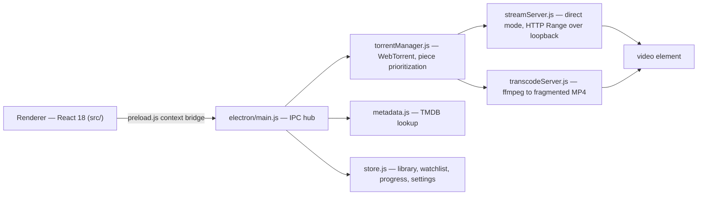

# Lumen

**Lumen** is a desktop app that turns a magnet link into an instant-playing video. Paste a magnet, drop a `.torrent`, and Lumen starts streaming it — no download-and-wait, no media server to set up.

## Features

- **Instant playback** — pieces are prioritized around the current playback position, so playback begins in seconds instead of minutes.
- **Direct play when possible** — `ffprobe` inspects the file; if the container and codecs are supported by the browser engine, the file streams straight from the local loopback server.
- **Transparent transcode fallback** — when direct play won't work (HEVC in Matroska, AC-3 audio, etc.), Lumen quietly rewrites the stream into a fragmented MP4 served by a local ffmpeg process. Same player, no dialog boxes.
- **Resume progress** — playback position is saved per title and restored the next time you open it.
- **Watchlist** — star a title to keep it in your library, separate from the recent history.
- **TMDB enrichment** — clean titles, year, and posters from TMDB when you provide an API key. Entirely optional; filenames are parsed for a title/year guess without one.
- **Local-only** — no accounts, no analytics, no telemetry. Torrent traffic is peer-to-peer; metadata lookups go only to TMDB, and only if you opt in.

## Quick start

Prerequisites: **Node.js 20+** and **pnpm 12** (`corepack enable` if you need it).

```bash
pnpm install
cp .env.example .env   # optional — add TMDB_API_KEY
pnpm dev               # Vite + Electron with hot reload
pnpm dist              # packaged installer for your OS
```

`pnpm dev` starts Vite on `127.0.0.1:5173` and launches Electron against it. Packaged builds land in `release/`.

## Scripts

| Script | Description |
| --- | --- |
| `pnpm dev` | Run Vite and Electron together, with hot reload |
| `pnpm build` | Build the renderer bundle with Vite |
| `pnpm start` | Launch Electron against the existing build |
| `pnpm dist` | Build, then package with electron-builder (`electron-builder.yml`) |
| `pnpm test` | Run all unit tests (`node --test electron/*.test.js`) |
| `pnpm test:metadata` | Run only the metadata/TMDB tests |
| `pnpm test:streams` | Run only the streaming/classification tests |
| `pnpm typecheck` | `tsc --noEmit` over the TypeScript renderer sources |

## Configuration

Lumen works out of the box; the knobs below are in **Settings** (gear icon) unless noted.

| Setting | Where | Default | Notes |
| --- | --- | --- | --- |
| `TMDB_API_KEY` | `.env` or Settings | — | Enables posters and clean titles. A key in the environment takes precedence over the one stored in Settings. |
| Cache folder | Settings | `<userData>/torrent-cache` | Where downloaded pieces live. Changing it applies to new torrents. |
| Keep downloaded pieces for library titles | Settings | on | When off, cached files for titles you remove from the library are deleted on quit. |

## Architecture

Everything runs in one Electron process. The renderer never touches the filesystem or the network directly — it talks to the main process through a small, explicit IPC bridge.



- **`electron/main.js`** — window lifecycle, `.env` loading, all `ipcMain` handlers, and error wrapping so the renderer always gets a `{ ok }` result.
- **`electron/torrentManager.js`** — owns the WebTorrent client, picks the largest video (and flags multi-file candidates), and reprioritizes pieces ahead of the playhead.
- **`electron/streamServer.js`** — direct mode: serves torrent bytes over `127.0.0.1` with range-request support.
- **`electron/transcodeServer.js`** — fallback mode: `ffprobe` classification plus a streaming ffmpeg remux/transcode into fragmented MP4.
- **`electron/store.js`** — JSON persistence via `electron-store`: library entries, watchlist, progress, and settings.
- **`src/`** — the single-page renderer (`src/components/streaming/`), hooks in `src/hooks/`, formatting helpers in `src/lib/`.

## Keyboard shortcuts

Available while the player has focus.

| Key | Action |
| --- | --- |
| `Space` / `k` | Play / pause |
| `m` | Mute |
| `f` | Fullscreen |
| `j` / `←` | Back 10s |
| `l` / `→` | Forward 10s |
| `<` / `>` | Playback rate down / up |
| `/` or `Ctrl`+`K` | Focus the magnet field |

## License

All rights reserved. *(Placeholder — license terms to be finalized.)*

## Legal note

Lumen is a tool for accessing content over the BitTorrent protocol. You are responsible for the legality of anything you download. Use it only for content you own or that is licensed for distribution in your jurisdiction.
